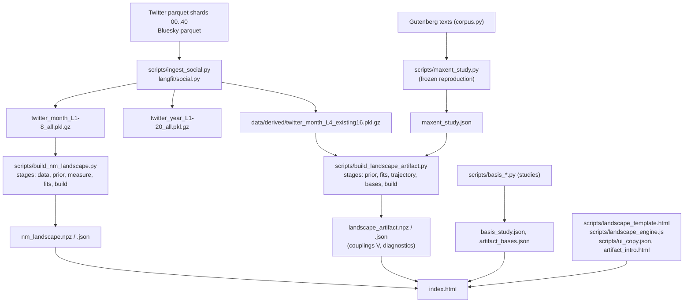

# Energy landscapes of words: codemap, documentation and code review

Repository: `languagefitness`. Snapshot: the state after the UI-simplification, smoothing-v4 and
new-model-path-removal rounds. Everything below was read from the source; where a statement is an
inference it is marked **[inference]**.

---------------------------------------------------------------------------------------------------

## 1. What the program does

It fits **pairwise maximum-entropy (Potts) models of English letter strings** to text corpora, turns
each model into an **energy landscape** `E(s) = -log2 P(s)` over strings, and renders that landscape as
an interactive page (`index.html` at the repo root, one self-contained ~21.7 MB file).

Two models share the page:

| | S&B model (tabs 1-2) | New model (tabs 3-4) |
|---|---|---|
| Strings | all 26^4 = 456,976 four-letter strings | words of length 1..8 on one grand-canonical scale |
| Model | pairwise max-ent, Stephens & Bialek (2010) | per-length pairwise max-ent + length prior P(L) |
| Fit | exact enumeration (dense, exact) | L<=5 exact MAP; L=6..8 pseudo-likelihood + exact log Z |
| Heights | bin energy `E_bin` in bits | `z`, bits relative to a per-length uniform prior |
| Moves | single-letter substitution | substitution, transposition, insertion, deletion |
| Data | Austen (S&B protocol), Twitter 2023, Bluesky 2024, Twitter pooled | Twitter, all 41 shards |

---------------------------------------------------------------------------------------------------

## 2. End-to-end pipeline



Run order (each stage cached; rerun only if inputs change):

```
.venv/bin/python scripts/ingest_social.py twitter --lengths 1-8 --period month --shards 0-40 --out twitter_month_L1-8_all.pkl.gz
.venv/bin/python scripts/maxent_study.py                      # frozen S&B reproduction -> maxent_study.json
.venv/bin/python scripts/build_landscape_artifact.py          # prior, fits, trajectory, bases, build
.venv/bin/python scripts/build_nm_landscape.py                # data, prior, measure, fits, build
.venv/bin/python scripts/build_landscape_artifact.py build    # cheap: only re-assemble the HTML (~40 s)
```

---------------------------------------------------------------------------------------------------

## 3. Codemap

### 3.1 `langfit/` (library; ~4.9 k lines)

| Module | Lines | Role | Key symbols |
|---|---|---|---|
| `corpus.py` | 117 | Download/clean Gutenberg text; fixed-length tokenisation | `fixed_length_words`, `word_list`, `AUSTEN` |
| `social.py` | 225 | Tweets/Bluesky -> time-binned word counts (clean, fastText language-ID, in-year dedup) | `ingest`, `clean`, `load_periods` |
| `maxent.py` | 563 | **Frozen** S&B model for L=4: `WordCounts`, `MaxEnt`, convex dual fit, CV prior, strict minima, descent | `fit`, `prior_lambda`, `select_prior`, `local_minima`, `descend` |
| `projection.py` | 299 | 2-D projection by indicator covariance; binning; `E_bin`; cell adjacency; persistence | `indicator_covariance`, `project`, `bin_energy`, `substitution_adjacency`, `persistence`, `significant_basins` |
| `basis.py` | 900 | Alternative 2-D bases (registry `BASES`: pca, coupling_spectral, energy_aligned, tempered_pca, lda, energy_metric) plus the TICA/VAMP/LPP research code | `compute_basis`, `pca_basis`, `occupied_components`, `energy_metric_layout` |
| `potts.py` | 556 | Dense Potts models for any L and clique order (used for L<=5 and the 3-body study) | `Potts`, `fit`, `select_prior` |
| `longwords.py` | 640 | L>5 models: pseudo-likelihood fit, exact log Z up to L=8, AIS beyond, descent | `fit_plm`, `exact_log_partition`, `ais_log_partition` |
| `edits.py` | 757 | Grand-canonical energy across lengths; move kinetics (sub/trans/ins/del); landscapes, basins, noisy-channel decoder | `Space`, `grand_canonical_energy`, `landscape`, `decode` |
| `nm_landscape.py` | 710 | New model assembly: length prior, per-length fits, bigram-profile projection, importance sampling, `z` combination, wells | `fit_length`, `combine_bin_energy`, `projected_wells`, `Proposal` |

### 3.2 `scripts/` (drivers and the artifact source)

| File | Lines | Role |
|---|---|---|
| `maxent_study.py` | 309 | Frozen reproduction of S&B; writes `maxent_study.json` |
| `ingest_social.py` | 54 | CLI for `social.ingest` (multiprocessing needs a real module) |
| `build_landscape_artifact.py` | 864 | S&B artifact build: stages `prior, fits, trajectory, bases, build`; assembles the HTML |
| `build_nm_landscape.py` | 928 | New-model build: stages `data, prior, measure, fits, build`; writes `nm_landscape.{npz,json}` |
| `landscape_template.html` | 2278 | **All page logic**: HTML, CSS, ~170 JS functions, five tabs |
| `landscape_engine.js` | 724 | Dependency-free JS port of the S&B pipeline (enumeration, binning, `E_bin`, persistence, barrier) plus `smoothField` |
| `ui_copy.json` | 70 | All user-facing short copy (single source of truth, read by the builder) |
| `artifact_intro.html`, `artifact_blurbs.json`, `artifact_bases.json` | 372/11/188 | Tab-0 theory (collapsed), blurbs, per-basis justifications |
| `basis_*.py`, `make_*_figures.py` | ~1.1 k | Projection-basis studies and figures |
| `length_study.py`, `ternary_study.py`, `edit_study.py` | 721/471/614 | Research studies behind `docs/first_pass/*.md` |
| `engine_golden.py` | 275 | Writes `tests/data/engine_golden.json` (reference outputs for JS parity) |

### 3.3 `tests/` (134 pytest functions + 3 JS checks)

`test_maxent` 13, `test_potts` 10, `test_longwords` 9, `test_edits` 16, `test_basis` 32,
`test_nm_landscape` 24, `test_landscape_artifact` 28, `test_engine_golden` 2. JS (run in the eval
tool's Bun, not pytest): `tests/js/engine_parity.mjs` (17 cases, max |dE_bin| ~5e-10 bits),
`tests/js/engine_edge.mjs`, `tests/js/smooth_check.mjs` (10 checks).

### 3.4 Data and docs

`data/derived/` (149 MB) holds the count pickles, fit caches (`landscape_artifact.*`,
`nm_landscape.*`), study outputs and basis studies. `docs/first_pass.md` assembles five fragment
write-ups in `docs/first_pass/`; reviews are in `docs/reviews/`.

---------------------------------------------------------------------------------------------------

## 4. The S&B model (`maxent.py`)

A four-letter word is a configuration of 4 "spins" with 26 states. With the six pairwise letter
marginals fixed, the maximum-entropy distribution is

```
P(s) = exp( sum_{i<j} V_ij(s_i, s_j) ) / Z          energy E(s) = -log2 P(s)  (bits)
```

- **Exact fit** (S&B protocol, Austen, Twitter-2023, Bluesky-2024): minimise the convex dual
  `log Z - <mu, V>` over cells with nonzero empirical marginal; the others are fixed at `-inf`
  (letter pairs never seen at positions (i,j) make a string impossible, `E = +inf`). Solver: trust-region
  Newton-Krylov, then Newton polish. Stopping rule is in units of sampling standard error (every marginal
  within 0.01 se, entropy error within 0.01 se).
- **MAP fit** (pooled Twitter and every trajectory frame): the same dual plus a Gaussian prior
  `V ~ N(0, sigma^2)`, `lam = 1/(2 sigma^2 N)`; every string gets finite energy. `sigma^2` = 3.162 chosen
  by 4-fold CV on the pooled tokens (`select_prior`).
- Everything (Z, marginals, entropies, local minima) is exact enumeration over 456,976 strings.
- **Strict minimum:** a string with `E` lower than all 100 single-letter neighbours (`local_minima`).
  **Known fragility:** Austen's count is 149 or 148 depending on a sub-fit-tolerance tie (`lamb`/`limb`,
  <4e-4 bits); the test is tolerance-aware.

---------------------------------------------------------------------------------------------------

## 5. From energies to a landscape (`projection.py`)

1. **Projection.** Each string is a one-hot vector `x(s)` of length 104 (4 positions x 26 letters).
   `C = Cov_P[x]` is computed exactly from the model's single-site and pair marginals. The default axes are
   the top-2 eigenvectors of `C` (PCA; classical MDS of the Hamming metric weighted by P).
   `x,y = U^T(x(s) - mean)`.
2. **Binning.** A G x G grid spans the per-axis min/max over all 26^4 strings (G=32 default).
   `cell = row(y)*G + col(x)`.
3. **Bin energy (Zwanzig average).** `E_bin = -log2( P(bin) / |bin| )` = the energy of the cell's
   mean string probability, computed as a per-cell log-sum-exp. Empty cells are NaN; cells whose strings
   are all forbidden are +inf. *This is a cell average, not the energy of any word.*
4. **Wells.** Local minima of `E_bin` on a cell graph, ranked by 0-D sublevel-set persistence
   (elder rule, `(value, index)` tie-break). Persistence = saddle height minus minimum; wells kept at
   persistence >= 1 bit. The default graph links two cells iff some string in one is one substitution from
   some string in the other (`substitution_adjacency`); the 8-neighbour grid is the alternative.
5. **Basins.** Each cell drains by steepest descent to a minimum; basins below the persistence threshold
   are merged upward (`significant_basins`).
6. **Barrier.** The most persistent non-essential well's saddle: `climb from Wa = E_saddle - E_min(a)`,
   `climb from Wb = E_saddle - E_min(b)`. Two numbers because they are the two climbs to the same pass.

### Why a well's label can differ from the word at its dot

`wells[i].words` = the three most probable strings of the **whole basin**; the label is the first. The dot
sits at the **minimum cell**, whose own top string is stored as `min_cell_top`. Example (Austen, PCA, 32x32):

| Well | Label (basin top) | Top word in minimum cell | Strings in that cell |
|---|---|---|---|
| W1-W3 | that, have, with | same | 1 each |
| W4 | very | more | 3 |
| W5 | from | were | 8 |
| W6 | time | tome | 1 |

---------------------------------------------------------------------------------------------------

## 6. Projection bases (`basis.py`, `artifact_bases.json`)

Registry `BASES`: `pca` (default), `coupling_spectral` (top eigenvectors of the centred coupling matrix),
`energy_aligned` (PLS: max covariance with energy), `tempered_pca` (covariance weighted by P^0.75),
`lda` (Fisher discriminant of descent basins), and `energy_metric` (diagnostic; per-string coordinates).
Findings recorded in `docs/first_pass/projection_basis.md`: no basis is smoother than PCA on the full
surface on the outlier-robust metric; roughness is dominated by within-cell energy spread (~6.8 bits), which
no linear map removes; the energy-driven layout is degenerate (y ~ the energy ramp, x ~ linear in indicators,
stress 0.88-0.92). Non-default bases change the layout and the wells, never the model.

---------------------------------------------------------------------------------------------------

## 7. Time evolution (`stage_trajectory`)

Twitter shards 00-15, cumulative month-binned four-letter counts 2006-03..2023-04. For each of 203 frames
(frame 0 = no data = uniform model) a MAP fit with `sigma^2 = 3.162`, `lam_t = 1/(2 sigma^2 N_t)`,
warm-started from the previous frame in 3 parallel chains. The projection basis is **fixed** at the final
model's axes, so a string keeps its (x,y) and only its energy changes. Couplings are stored as `V_traj`
(203 x 6 x 26 x 26) and embedded float32; the browser recomputes each frame with the engine.

---------------------------------------------------------------------------------------------------

## 8. The new model (`nm_landscape.py`, `build_nm_landscape.py`)

- **Per-length model** `P_L(s) = exp(sum V^L_ij) / Z_L`, Gaussian prior per length (sigma^2 by CV: 3.16 for
  L = 2,3,4,6,7,8; 10 for L = 5). L=1 uniform; L<=5 exact MAP (`potts`); 6<=L<=8 maximum pseudo-likelihood
  (`longwords`) with exact `Z_L` from split enumeration. Fits use a common N = 2e6 tokens per length.
- **Length prior** `P(L)` = Dirichlet(1) posterior mean over the 8 lengths. Grand-canonical energy
  `E(w) = -log2 P(L) - log2 P_L(w)`.
- **Frames:** empty frame + 18 cumulative yearly thresholds 2006..2023-04 (19 frames).
- **Projection:** boundary-marked bigram profile (27^2 = 729 bigrams, `#` marks word edges); the x,y of a word
  is the sum over its L+1 bigrams of the axis loadings; axes = top-2 PCA of that profile under the final model.
- **Height:** `z = log2 P_prior(bin) - log2 P(bin)`, prior = uniform over lengths then uniform within a length.
  Empty frame is exactly flat. `|bin|` cancels, so only mass ratios are needed.
  - L<=5: every string enumerated, exact.
  - L=6..8: **importance sampling** (2e6 draws per length; proposal = 0.5 independent + 0.5 empirical), unbiased
    with per-cell standard errors. Effective sample sizes: ~1139 / 76 / 10 at L = 6 / 7 / 8; cells dominated by
    L = 7-8 are flagged low-confidence (their SEs are lower bounds).
- **Wells:** minima of `z` on the move-set cell graph (32x32); grid-8 at other resolution levels
  (8, 12, 16, 24, 32, 48, 64, 96, precomputed). A well is shown only if > 50% of its basin's mass is
  confidently estimated and it holds >= 1e-3 of the model's mass.
- **Names:** basin's most probable strings by `P(w) = P(L) P_L(w)`; approximate (sampled, L>=6) strings are `*`.
- **Limits (see `docs/first_pass/new_model_landscape.md`):** heights are mass ratios, not comparable across
  lengths or with the S&B tab; the L=6..8 part of the surface is exploratory.

---------------------------------------------------------------------------------------------------

## 9. The browser: engine and page

### 9.1 `landscape_engine.js`

`LandscapeEngine.compute({V, U1, U2, mean, extent, G, topK})` enumerates all 26^4 strings in one nested
loop with accumulated partial sums, then returns `Ebin, count, mass, x, y, words/wordP (top-K strings per
cell), occupancy, lws, energyAt/probAt`, a per-cell string index and `nearestInCell`. `persistence()`,
`barrier()`, `gridAdjacency()`, `substitutionAdjacency()` are byte-for-byte ports of `projection.py`.
~10 ms per recompute at G=32..128 under Bun. A `coords` mode accepts per-string coordinates (the
energy-metric diagnostic). `smoothField` (section 9.4) lives here too.

### 9.2 `landscape_template.html` (structure)

Placeholders `__PLOTLY__ __INTRO__ __ENGINE__ __DATA__` are replaced by the builder; `D` is the embedded
JSON (models, trajectory couplings, bases registry, new-model data, `ui_copy`). Function groups:

| Lines (approx.) | Group |
|---|---|
| 160-230 | copy binding, sidebar builders (`sidebarHead`, `compactWellsTable`, `sidebarLegend`) |
| 230-470 | tiles, colour bar, well traces/annotations, scene and heatmap layouts |
| 504-700 | basis view model, `engineCompute`, `displayWells`, `engine2dTraces`, nearest-word label |
| 696-920 | **minimax path** (`minimaxPath`, `computePath`, `densifyPath`, `pathTrace2D/3D`, panel) |
| 920-1230 | `renderEngine2D/3D`, smoothing glue (`smoothFieldOf`, `smoothedZAt`), hover text builders |
| 1229-1360 | tab 1 (`renderLandscape`, `renderPanel1`) |
| 1394-1700 | tab 2 trajectory (`renderTraj`, `renderTrajEngine2D/3D`, lines plot, play/slider) |
| 1700-2200 | tabs 3-4 new model (`renderNM`, `renderNMTraj`, level slider, cell-word hover) |
| 2216-2278 | hover binding, `showTab` |

**Render routing (tab 1).** 2D always goes through `renderEngine2D`. 3D uses the precomputed Python surface
only for PCA, G=32, smooth off; smoothing, any other basis or any other G uses the engine path
(`renderEngine3D`). Wells at G=32/PCA come from Python (`m.wells`); other G use the engine's substitution
adjacency, cached per (model, basis, G).

### 9.3 The mutation path (what the maroon line is)

1. **Endpoints:** the top basin word of the two selected wells (default: the main barrier's pair).
2. **Search (`minimaxPath`):** a widest-path Dijkstra on the 26^4 string graph. Nodes are strings, edges are
   single-letter substitutions, forbidden strings are excluded. It maximises the minimum log-weight along the
   path, which is the same as minimising the highest energy `E(s)`; ties go to fewer steps. Result for
   Austen: `have -> hame -> same -> sade -> made -> mare -> more -> were -> wore -> went -> sent -> seat
   -> meat -> mean -> meen -> ween -> when -> then -> than -> that`, peak `mean` at 11.63 bits (an independent
   union-find check on the fit gives 11.634 bits; `that`<->`with` gives 12.147). It depends on the model's
   energies only, not on the basis or the grid.
3. **Drawing:** the 20 vertices are real strings; each is projected to (x,y) in the **current** basis.
   Consecutive vertices are joined by a straight (x,y) segment sampled 10 times; each sample's height is the
   height of the surface actually drawn under it (+0.1): the cell's `E_bin` (discrete) or the smoothed field
   (smooth). Samples over empty cells are NaN, so the solid line breaks there, and a dotted bridge connects
   the bounding finite samples.
4. **What is, and is not, a word:** **only the vertices correspond to strings**. A single-letter change can
   jump far across the plane (e.g. `went -> sent` moves ~0.5 in x), so the straight line in between passes
   over cells that have nothing to do with the transition. A vertex is drawn at its **cell's** `E_bin`, not at
   its own `E(s)` (e.g. `sent`: cell average 18.77 bits, its own energy 10.81 bits, in a cell of 7,707 strings),
   so it can look far above or below its true energy; the hover shows the true `E(s)`.
5. **Hover:** vertex markers show `word, E(s)`. Every interpolated sample shows
   "on the path, nearest word: <nearer vertex>" (this was added because the interpolated samples previously
   had no tooltip, which is why transition words rarely appeared on hover).

### 9.4 Smoothing (`smoothField`, display only)

Boltzmann-domain kernel regression on a finer grid (up to 4 points per cell): `v~ = vmin - log2(N/D)`,
`N = sum K K w 2^-(v-vmin)`. Two scales (`sigma_min = max(0.5, 0.4 sigma_max)`, `sigma_max` = slider,
default 1.5 cells) are blended by a local-variation map. **Capped mode:** empty cells enter as weak
pseudo-observations at the cap (weight 0.25), occupied-but-capped cells at 0.5, data at 1; nothing is pinned
and the fit is exactly the cap far from data. **Uncapped:** no pseudo-observations, NaN where data-kernel
mass < 0.15. Smoothing never changes wells, barrier or path numbers; it lowers barriers (pooled/PCA/32: raw
12.09 bits vs smoothed 10.03 bits). Measured: an empty cell three cells from a lone 6.8-bit well sits 2.2 bits
below the cap; the well keeps ~70% of its depth.

### 9.5 Hover

One dropdown (`off, top-1, top-3, top-5, nearest`). Tooltip format: `x ... y ...`, the cell's raw `E_bin`
(or `z`), top-n words with probabilities (new model: approximate words marked `*`), and, on smoothed
surfaces, a muted `smoothed ≈ ...` line. Empty cells: `E_bin = — bits (no strings here)`.

---------------------------------------------------------------------------------------------------

## 10. Reproducibility notes

- Caches are plain `.npz/.json`; the HTML is a pure function of caches + template + engine + copy files.
- `build_landscape_artifact.py build` (~40 s) needs no refit. Do not use hand "byte-identical reassembly".
- Seeds: `np.random.seed(0)` is set but does **not** pin multithreaded BLAS ordering.
- Plotly and KaTeX load from `cdnjs.cloudflare.com`: the page needs network.

---------------------------------------------------------------------------------------------------

## 11. Code review

Read-only review; no code was changed for it. Ordered by consequence.

### Correctness / behaviour

1. **Wells depend on the resolution and the adjacency, and the page mixes two definitions.** Python wells
   (substitution graph) at G=32/PCA; engine wells (substitution graph, cached) elsewhere; new-model wells use the
   move graph at 32 and the 8-neighbour grid at other levels. A user changing resolution can see wells appear or
   vanish for reasons unrelated to the language. It is labelled in Technical details but not in the main view.
2. **A well is a cell, a label is a basin.** By design, but surprising; now explained in the legend. Consider
   showing the minimum-cell word in the on-plot label (e.g. `W4 very (min: more)`).
3. **The mutation path is drawn on cell averages.** Vertices sit at `E_bin`, not `E(s)`; interpolation is
   linear in the plane, so most of the line is not data (section 9.3). Consider drawing vertices at their own
   `E(s)` as a separate marker trace and drawing only the vertices as the "path".
4. **Austen strict-minima count is not stable (148/149).** Depends on a sub-tolerance tie; fit is not bitwise
   reproducible (BLAS threads). Test is tolerance-aware; the page footnotes it.
5. **New model, L=7-8 estimates are weak.** ESS 76 and 10; SEs are lower bounds; heights are not comparable
   across lengths. Documented; 2-D view whitens such cells, 3-D does not mark them (the 3-D marking caused
   rendering artefacts and was removed).
6. **Smoothing is a soft-min.** It keeps wells deep but lowers barriers and ridges; displayed passes are lower
   than the reported barrier numbers. Documented in the tooltip.

### Dead code and stale state (left by the removal of the precomputed spline)

7. **Dead JS:** `decodeSmooth`, `fineGrid`, `smoothFrameRows`, the `smoothMode` branch of `heatmapTraces`, the
   `TB.smooth` / `NT.smooth` branches in `renderTraj`/`nmSmooth`, and the "smoothed every k frames" `strideNote`.
   The build no longer writes any `smooth` field, so these never run. The stride note's text is wrong if reached.
8. **Dead data and constants:** `SUB`, `SUB_TRAJ`, `BASIS_SMOOTH_STRIDE` are still defined and embedded in `D`
   (`sub`, `sub_traj`, `bases_smooth_stride`), but the template never reads `D.sub` or `D.sub_traj`.
9. **Possibly redundant payload [inference]:** `stage_bases` still precomputes the whole trajectory surface for
   every non-PCA basis (`bases_traj`, ~4 bases x 203 frames of int16). Tab 2 routes to the engine for smoothing,
   non-32 resolution and the energy-metric basis; the precomputed path is only used for unsmoothed 3D at G=32.
   Worth measuring whether the engine could replace it and shrink the file.
10. **Stale comment numbering** in the template ("tab 3 (S&B trajectory)" is tab 2).

### Structure and maintainability

11. **One 2,278-line file with ~170 top-level functions and implicit global state** (`SMOOTHED_FIELD`,
    `PATH_BREAKS`, `NM_CW`, `PATH_CACHE`). Render functions read DOM controls directly and mutate globals.
12. **Four near-duplicate render pipelines:** tab 1 and tab 2 each have a precomputed path and an engine path
    in 2D and 3D, and tabs 3-4 repeat the pattern (`renderEngine3D` vs `renderTrajEngine3D`; `renderNM` vs
    `renderNMTraj`). Most bugs this round (wells changing with smoothing, hover missing on one path, stale
    labels) came from a fix applied to one copy and not the others. A single `grid -> traces` function plus a
    thin per-tab wrapper would remove that class of bug.
13. **Scripts import scripts** (`build_landscape_artifact.py` imports `maxent_study`, edits `sys.path`); the
    library/script boundary is blurred. `maxent.py` is "frozen" by convention only.
14. **Parallel Potts implementations:** `maxent.py` (L=4, frozen), `potts.py` (any L/order) and `longwords.py`
    (PLM). `potts.py` re-implements `maxent.fit` with a different API; a test pins their agreement, but the
    duplication is a maintenance cost.
15. **Magic numbers in display code** (`0.25`, `0.5`, `0.02`, `rho0 = 3`, `lift 0.1/0.2`, `N = 10`
    samples/segment) are documented in comments, not in one config object.

### Testing

16. **The page's JS has no automated browser test in the repo.** Pytest checks the built HTML by string search
    (e.g. no `markers+text`, no `GCV`, every surface has `highlight:false`); hover, path and smoothing
    behaviour were verified by hand/DOM probes. The JS engine and smoother are tested through plain-assert
    modules run in the eval tool, not in CI. A Playwright/puppeteer smoke test (load, switch tab/basis/G,
    smooth on/off, scan tooltips for `—` on finite tiles and for words) would have caught most defects found
    in this session.
17. **Full-suite runtime is ~30 minutes** (potts and longwords fits dominate); on a memory-starved machine it
    did not finish. Tag the slow tests so the artifact suite (114 tests, ~11 s) is the default gate.
18. **Network dependence:** Plotly and KaTeX from a CDN; the artifact is not offline-capable.

### What is solid

- `projection.py` and the engine agree to 5e-10 bits on 17 golden cases (including forbidden strings, empty
  cells, G=1 and G>strings/axis).
- The minimax path matches an independent union-find threshold search.
- The S&B reproduction (`maxent_study.py`) reproduces the published S_2 within 1.4e-5 bits and is checked on
  every build (`S2_TOL`).
- Persistence uses an explicit, documented convention (elder rule, essential minimum paired with the
  component's highest value, `(value, index)` tie-break) and is tested on hand-built grids.
